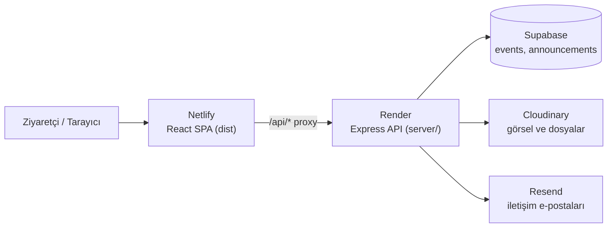

# İlim Yayma Cemiyeti Kepez Yurdu - Kurumsal Web Uygulaması

Bu proje, İlim Yayma Cemiyeti Antalya Kepez Erkek Öğrenci Yurdu için hazırlanmış kurumsal bir web uygulamasıdır. Ziyaretçilere yurdun imkanlarını tanıtır, iletişim formunu dijital ortama taşır ve etkinlik/duyuru içeriklerini yönetim panelinden güncellemeyi sağlar. Arama motorlarında iyi görünmesi de gözetilmiştir.

**Canlı site:** https://iyckepez.org.tr

## Ekran Görüntüleri

> Bu bölüm için ekran görüntüleri eklenecek.

| Ana Sayfa | Yurdumuz | Etkinlikler |
|---|---|---|
| _(görsel eklenecek)_ | _(görsel eklenecek)_ | _(görsel eklenecek)_ |

Görseller `docs/screenshots/` klasörüne eklenip `` biçiminde bağlanabilir.

## Öne Çıkan Özellikler

* **SEO ve meta yönetimi:** JSON-LD şemaları (WebSite, Organization, Place), Open Graph etiketleri, sayfa bazlı başlık/açıklama/canonical, `sitemap.xml` ve `robots.txt`.
* **Duyarlı arayüz:** Mobil, tablet ve masaüstü ekranlara uyumlu tasarım.
* **Yönetim paneli (`/admin`):** Etkinlik ve duyuru ekleme/silme, görsel ve dosya yükleme.
* **İletişim formu:** Mesajlar Resend üzerinden e-posta olarak iletilir. Kötüye kullanıma karşı IP tabanlı istek sınırı vardır.
* **Sürekli entegrasyon (CI):** GitHub Actions her push ve pull request'te `npm ci`, `npm run lint` ve `npm run build` çalıştırır.
* **Otomatik dağıtım:** Netlify ve Render, kendi Git entegrasyonlarıyla dağıtım yapar. Bu entegrasyonlar GitHub Actions'tan bağımsızdır.

## Kullanılan Teknolojiler

| Katman | Teknoloji |
|---|---|
| Frontend | React 19, React Router 7, Vite 7, Swiper |
| Backend | Node.js, Express |
| Veritabanı | Supabase (PostgreSQL) |
| Dosya depolama | Cloudinary |
| E-posta | Resend |
| Barındırma | Netlify (frontend), Render (backend) |

## Mimari



* Frontend Netlify üzerinde statik olarak yayınlanır.
* Tarayıcı API isteklerini aynı alan adındaki `/api/*` yoluna gönderir. Netlify bu istekleri `netlify.toml` içindeki yönlendirme kuralıyla Render'daki backend'e proxy'ler.
* Backend etkinlik ve duyuru verilerini Supabase'de, yüklenen görsel ve dosyaları Cloudinary'de saklar. İletişim formu mesajlarını Resend ile e-posta olarak gönderir.
* Geliştirme ortamında Vite, `/api` isteklerini `http://localhost:5174` adresine yönlendirir (`vite.config.js`).

## Proje Yapısı

```text
.
├── .github/workflows/ci.yml   # GitHub Actions: lint + build
├── index.html                 # HTML şablonu, meta etiketleri ve JSON-LD
├── netlify.toml               # Netlify yönlendirme kuralları (/api, /uploads, SPA)
├── vite.config.js             # Vite ayarları ve geliştirme proxy'si
├── eslint.config.js
├── package.json               # Frontend bağımlılıkları ve script'leri
├── public/                    # Statik dosyalar (logo, fotoğraflar, sitemap, robots)
├── src/
│   ├── main.jsx               # Uygulama giriş noktası
│   ├── App.jsx                # Rotalar
│   ├── components/            # HomeHeroSlider, MiniMaps
│   ├── pages/                 # Sayfa bileşenleri (Home, Kurumsal, Yurdumuz, Etkinlikler, Duyurular, İletişim, Admin, 404)
│   └── css/                   # Sayfa ve bileşen stilleri
└── server/
    ├── index.js               # Express API
    ├── package.json           # Backend bağımlılıkları
    └── .env.example           # Ortam değişkeni şablonu
```

## Kurulum

Gereksinim: **Node.js 20 veya üzeri**.

### 1. Frontend

```bash
npm install
npm run dev        # http://localhost:5173
```

Diğer komutlar:

```bash
npm run lint       # ESLint
npm run build      # Üretim derlemesi (dist/)
npm run preview    # Derlemeyi yerelde önizleme
```

### 2. Backend (server)

```bash
cd server
npm install
cp .env.example .env   # Windows: copy .env.example .env
# .env dosyasındaki değerleri doldurun
npm start              # http://localhost:5174
```

Backend'i kök dizinden `npm run server` ile de başlatabilirsiniz. Bunun için önce `server/` içinde `npm install` çalıştırılmış olmalıdır.

> **Not:** `ADMIN_USER` ve `ADMIN_PASS` tanımlı değilse sunucu başlamaz.

Geliştirme sırasında frontend (`npm run dev`) ve backend (`cd server && npm start`) ayrı terminallerde çalıştırılır. Vite proxy'si `/api` isteklerini backend'e iletir.

## Ortam Değişkenleri

Backend değişkenleri `server/.env` dosyasında veya barındırma platformunun (Render) ortam değişkeni ayarlarında tanımlanır.

| Değişken | Zorunlu | Açıklama |
|---|---|---|
| `PORT` | Hayır | API portu. Varsayılan: `5174` |
| `ADMIN_USER` | **Evet** | Yönetim paneli kullanıcı adı |
| `ADMIN_PASS` | **Evet** | Yönetim paneli şifresi |
| `CORS_ORIGIN` | Hayır | İzin verilen origin'ler, virgülle ayrılmış. Varsayılan: `https://iyckepez.org.tr,http://localhost:5173` |
| `SUPABASE_URL` | Evet* | Supabase proje URL'si |
| `SUPABASE_SERVICE_ROLE_KEY` | Evet* | Supabase service role anahtarı (gizli tutulmalı) |
| `CLOUDINARY_CLOUD_NAME` | Evet* | Cloudinary hesap adı |
| `CLOUDINARY_API_KEY` | Evet* | Cloudinary API anahtarı |
| `CLOUDINARY_API_SECRET` | Evet* | Cloudinary API gizli anahtarı |
| `RESEND_API_KEY` | Evet* | Resend API anahtarı (iletişim formu) |
| `TO_EMAIL` | Evet* | İletişim formu mesajlarının gönderileceği adres |

\* Sunucu bunlar olmadan da başlar, ancak ilgili özellik (etkinlik/duyuru, dosya yükleme, iletişim formu) hata döner.

## Veritabanı (Supabase)

Backend iki tablo kullanır. Aşağıdaki sütunlar `server/index.js` içindeki `dbInsertEvent` / `dbInsertAnnouncement` ve okuma fonksiyonlarından çıkarılmıştır. Tipler önerilen tiplerdir.

### `events`

| Sütun | Önerilen tip | Açıklama |
|---|---|---|
| `id` | `bigint` (PK) | Uygulama tarafından `Date.now()` ile üretilir |
| `title` | `text` | Etkinlik başlığı |
| `date` | `text` / `date` | Etkinlik tarihi |
| `description` | `text` | Açıklama (boş olabilir) |
| `image_url` | `text` | Kapak görseli URL'si (ilk görsel) |
| `images` | `jsonb` (URL dizisi) | Tüm görsel URL'leri |
| `cloudinary_public_ids` | `jsonb` (metin dizisi) | Silme işlemi için Cloudinary public ID'leri |
| `created_at` | `timestamptz`, varsayılan `now()` | Sıralama için kullanılır, veritabanı tarafından doldurulur |

### `announcements`

| Sütun | Önerilen tip | Açıklama |
|---|---|---|
| `id` | `bigint` (PK) | Uygulama tarafından `Date.now()` ile üretilir |
| `title` | `text` | Duyuru başlığı |
| `text` | `text` | Duyuru metni |
| `images` | `jsonb` | `[{ url, name, publicId }]` biçiminde görsel listesi |
| `file` | `jsonb` (null olabilir) | `{ url, name, publicId, resourceType }` biçiminde ek dosya |
| `created_at` | `timestamptz`, varsayılan `now()` | Sıralama için kullanılır, veritabanı tarafından doldurulur |

## API Uç Noktaları

| Yöntem | Yol | Yetki | Açıklama |
|---|---|---|---|
| GET | `/api/health` | - | Sağlık kontrolü |
| POST | `/api/admin/login` | - | Yönetici girişi, token döner |
| POST | `/api/admin/logout` | Bearer | Oturumu kapatır |
| POST | `/api/contact` | - | İletişim formu (IP başına 10 dakikada 5 istek) |
| GET | `/api/events` | - | Etkinlik listesi |
| POST | `/api/events` | Bearer | Etkinlik ekler (multipart, `images`) |
| DELETE | `/api/events/:id` | Bearer | Etkinlik siler |
| GET | `/api/announcements` | - | Duyuru listesi |
| POST | `/api/announcements` | Bearer | Duyuru ekler (multipart, `images` + `file`) |
| DELETE | `/api/announcements/:id` | Bearer | Duyuru siler |

## Lisans

Bu proje [Apache License 2.0](LICENSE) ile lisanslanmıştır.
